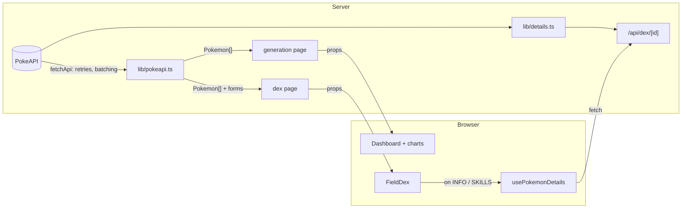

# Architecture

[← Wiki home](README.md)

## Routes

| URL | File | Rendering |
|---|---|---|
| `/` | `app/page.tsx` | Redirects to `/generation/1` |
| `/generation/[gen]` | `app/generation/[gen]/page.tsx` | Static, one page per region, regenerated daily |
| `/dex` | `app/dex/page.tsx` | Redirects to `/dex/1` |
| `/dex/[gen]` | `app/dex/[gen]/page.tsx` | Static, one page per region, regenerated daily |
| `/api/dex/[id]` | `app/api/dex/[id]/route.ts` | Built on first request per id, then cached a day |
| `*/opengraph-image` | `opengraph-image.tsx` next to each page | Link-preview PNGs drawn from real data |

Both page routes use `generateStaticParams` for the nine regions with
`dynamicParams = false`, so `/generation/10` is a 404. Both also set
`revalidate = 86400` (one day).

## Server vs client

- **Pages are Server Components.** They fetch, slim the data to the `Pokemon` shape
  in `lib/types.ts`, and pass it as props. The browser never talks to PokeAPI for
  region data.
- **`Dashboard` and `FieldDex` are the client roots** (`'use client'`). Each one owns
  its page's interactive state and passes it down. There's no global store.
- **Heavy per-entry data** (abilities, move lists, evolution, forms) would bloat
  every page, so it's served on demand by `/api/dex/[id]` and fetched by the
  `usePokemonDetails` hook only when a tab needs it. See
  [Data and caching](data-and-caching.md).

## Conventions

- **Charts draw, they don't compute.** Shaping lives in pure functions
  (`lib/transforms.ts` for the charts page, `lib/dex.ts` for the Field Dex).
  Components call them inside `useMemo`.
- **Lessons in comments.** Each chart and visual component opens with a
  `// Lesson:` comment explaining the visualisation choice. Keep that habit when
  adding one.
- **No inline colours in CSS rules.** Components set CSS custom properties from
  data and the Sass reads them. See [Styling](styling.md).
- **Accessibility is part of "done":** real `<button>`s, `aria-label`s on visual-only
  marks, 44px touch targets, `:focus-visible` rings, and a table or text equivalent
  for every chart.

## Loading states

- **Dev only:** `DevSuspense` wraps the data-loading part of each page in
  `<Suspense>` with a spinner panel, because `next dev` fetches on request. In
  production the pages are pre-built, and a Suspense boundary would ship the
  spinner in the static HTML, so it's skipped. See the comment in
  `components/DevSuspense.tsx`.
- **Region switching** (charts page) keeps the old readouts dimmed while the new
  page loads (`RegionPicker`, `useLinkStatus` + CSS `:has()`).
- **Per-entry details** show a small spinner inside the tab, and a Retry button if
  the request fails.

## Metadata and previews

`lib/metadata.ts` builds each page's complete `openGraph`/`twitter` objects, because
Next replaces the layout's objects instead of merging them. Preview images are
generated by `lib/og.tsx` + `lib/og-cards.tsx`. For a custom domain, set
`NEXT_PUBLIC_SITE_URL`.
